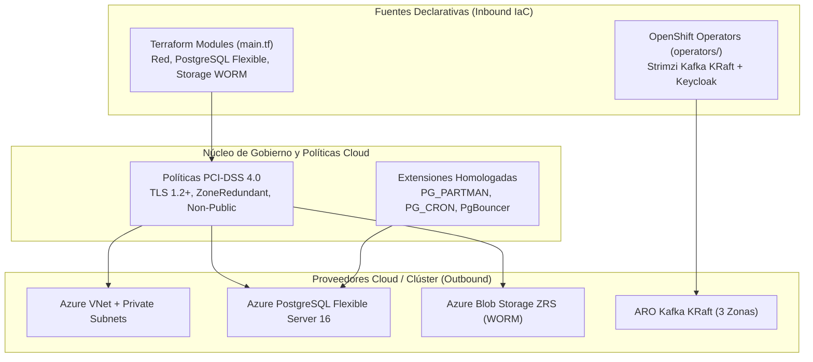
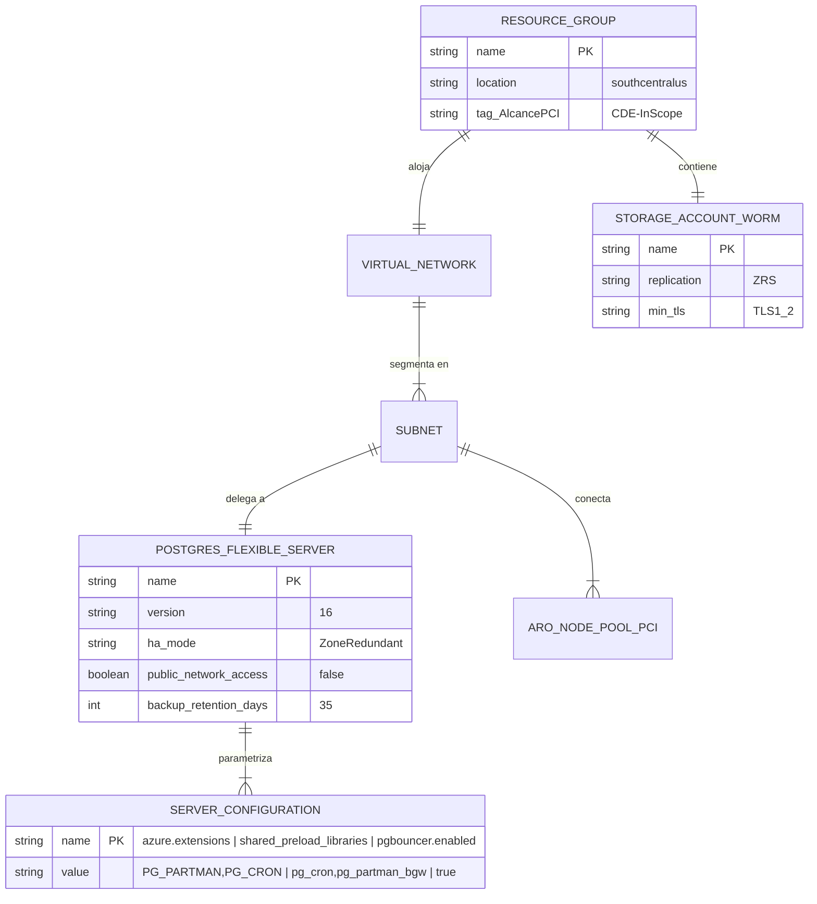
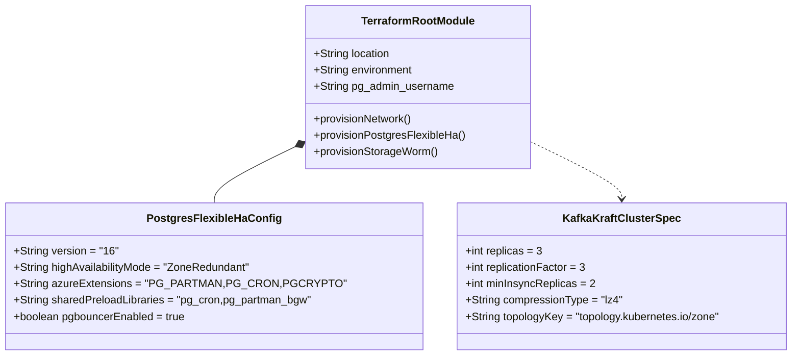
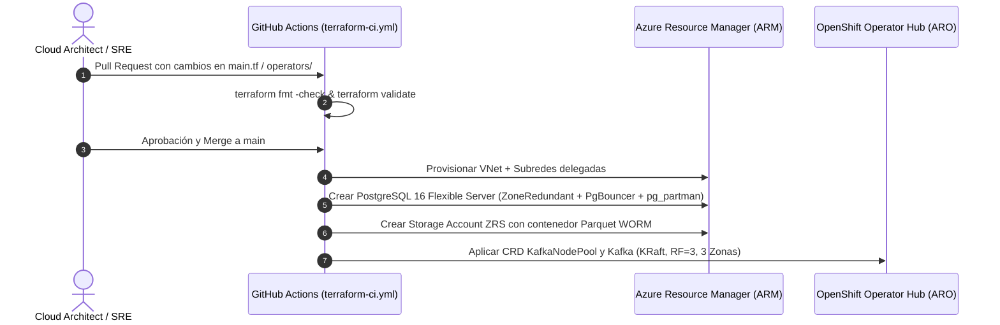

# `xpos-infra-aro-terraform` — Infraestructura como Código (ARO 3 Zonas + PostgreSQL Flexible HA + Blob WORM)

Repositorio de Infraestructura como Código (Terraform + Operadores de OpenShift) para aprovisionar la **Opción 3 Híbrida Recomendada** en Azure Red Hat OpenShift (ARO).

---

## 1. Especificación Funcional

1. **Aislamiento de Red y Segmentación PCI-DSS (Principio P2):** Crea subredes dedicadas para los Worker Nodes del CDE (`snet-aro-workers-pci-cde`) y delegación privada VNet (`snet-postgres-flexible-ha`) con acceso público deshabilitado (`public_network_access_enabled = false`).
2. **Alta Disponibilidad Multi-Zona (Principio P4):**
   - **Streams for Apache Kafka (KRaft):** `replicas: 3`, `default.replication.factor: 3`, `min.insync.replicas: 2`, `rack.topologyKey: topology.kubernetes.io/zone`.
   - **Azure Database for PostgreSQL Flexible Server:** `ZoneRedundant` (Primario en Zona 1, Standby síncrono en Zona 2), PgBouncer integrado y extensiones `PG_PARTMAN` + `PG_CRON` habilitadas.
3. **Archivo Frío Inmutable (WORM):** Cuenta de almacenamiento `ZRS` con TLS 1.2 mínimo para exportar las particiones cerradas de `bitacora_auditoria` en formato Parquet inmutable por 13 meses.

---

## 2. Especificación Técnica y Diagrama de Arquitectura Hexagonal de Infraestructura



---

## 3. Modelo de Datos de Estado e Inventario de Recursos (ER Diagram)



---

## 4. Diagrama de Clases / Módulos de Infraestructura



---

## 5. Diagrama de Secuencia de Aprovisionamiento Automatizado



---

## 6. Códigos de Estado y Compuertas de Cumplimiento

| Código / Regla | Componente | Criterio Obligatorio |
| :--- | :--- | :--- |
| `IAC-PCI-NET-01` | PostgreSQL Flexible Server | `public_network_access_enabled = false` (solo VNet privada) |
| `IAC-PCI-PG-02` | Extensiones de Particionamiento | `azure.extensions = PG_PARTMAN,PG_CRON,PGCRYPTO` |
| `IAC-HA-KAF-03` | Streams for Apache Kafka | `default.replication.factor = 3` y `min.insync.replicas = 2` |
| `IAC-PCI-WORM-04` | Azure Blob Storage | `min_tls_version = TLS1_2` y replicación `ZRS` |

---

## 7. Runbook Operativo de Infraestructura

1. **Validación Local:**
   ```bash
   terraform init -backend=false
   terraform validate
   ```
2. **Prueba de Failover de Zona en PostgreSQL Flexible Server (Chaos Testing del Piloto):**
   ```bash
   az postgres flexible-server restart --resource-group rg-xpos-integracion-aro-prod-pci --name psql-xpos-reversos-prod-pci --failover Forced
   ```
   Verificar que el RTO sea menor a 60 segundos y que el servicio Quarkus reconecte transparentemente a través de PgBouncer sin perder mensajes de Kafka.
